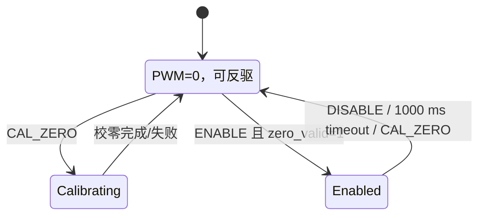

# BDC_CTRL 电机驱动板通信接口协议（轮询应答版）

> **协议版本**：2.1  
> **适用固件**：`BDC_CTRL_C011F6`  
> **链路模式**：USART1 双线异步全双工、按 ID 轮询  
> **安全默认值**：驱动板上电后电机失能；Flash 中没有有效零点时，`ENABLE` 指令会被拒绝。

---

## 1. 物理层

| 项目 | 参数 |
|---|---|
| UART | USART1 |
| 驱动板 TX | PB6（USART1_TX） |
| 驱动板 RX | PB7（USART1_RX） |
| 电气方式 | TX/RX 分线、UART 全双工、推挽输出 |
| 波特率 | **460800 bit/s** |
| 主控接线 | 主控 TX → PB7；PB6 → 主控 RX；双方 GND 共地 |
| 数据格式 | 8N1：8 数据位、无校验、1 停止位 |
| 字节序 | Little-Endian |
| 浮点格式 | IEEE-754 `float32`、Little-Endian |
| 总线角色 | F411 主控为 UART 主机；PC 经主控下发命令，驱动板仅在自身被轮询后回传 |

接线时交叉连接主控 TX/RX 与驱动板 PB7/PB6，并共地。USART1 接收与发送分别使用独立引脚，驱动板收发不再改变引脚方向。

> **多板接线注意**：PB6 为推挽 TX；多个驱动板的 PB6 不可直接并联到同一主控 RX。多板系统须使用独立接收通道，或采用带三态/总线仲裁能力的外部收发电路，确保同一时刻至多一个驱动板驱动共享的接收线。

一个字节在 8N1 下占 10 bit，因此 460800 baud 的单字节传输时间约为：

$$
t_{byte}=\frac{10}{460800}\approx21.7\ \mu s
$$

---

## 2. 设计规则

1. F411 主控一次只轮询一块板；每块板有唯一 `id`，范围为 0～16。
2. 驱动板只接受 `id` 与自身 ID 相同的请求；其它板的请求不响应、不刷新通信看门狗。
3. 每个有效单板请求都会触发一帧状态回传。
4. 广播 ID `0xFF` 仅允许 `BDC_CMD_DISABLE`；广播帧**不会收到回传**，且不刷新 1000 ms 通信看门狗。
5. 所有帧使用固定长度、帧头、序号和 CRC-16/CCITT-FALSE。
6. 主控等待回传帧或单板超时后，再轮询下一块板。
7. 当前 F411 对每个 ID 保存一个最新命令并每轮重发；这不是命令队列。同一 ID 的连续命令可能在发送前被后一个覆盖。驱动板仅回显 `sequence`，不用于去重或确认命令已成功执行。

---

## 3. 驱动板 ID

在 `BDC_CTRL\bdc_motor.h` 中设置编译期 `BOARD_ID`（默认 8），或通过编译器宏覆盖；每块板须分别烧录对应的唯一 ID。越界配置会在编译期报错。`BDC_Motor_Init` 使用同一 ID 选择电机型号并初始化协议，不存在运行时改 ID 的命令。ID 和关节映射如下：

| ID | 手指 | 关节 | 电机型号 |
|---:|---|---|---|
| 0 | 拇指 | CMC_FE | N20_1024 |
| 1 | 拇指 | CMC_Rotation | N20_1218 |
| 2 | 拇指 | MCP_FE | N20_1024 |
| 3 | 拇指 | PIP_FE | N20_1218 |
| 4 | 拇指 | DIP_FE | N20_1218 |
| 5 | 食指 | MCP_AA | N20_1024 |
| 6 | 食指 | MCP_FE | N20_1024 |
| 7 | 食指 | PIP_FE | N20_1218 |
| 8 | 食指 | DIP_FE | N20_1218 |
| 9 | 中指 | MCP_AA | N20_1024 |
| 10 | 中指 | MCP_FE | N20_1024 |
| 11 | 中指 | PIP_FE | N20_1218 |
| 12 | 中指 | DIP_FE | N20_1218 |
| 13 | 无名指 | MCP_AA | N20_1024 |
| 14 | 无名指 | MCP_FE | N20_1024 |
| 15 | 无名指 | PIP_FE | N20_1218 |
| 16 | 无名指 | DIP_FE | N20_1218 |

默认 ID 8 对应食指 DIP_FE。型号来自现有 `motortype` 表，实际装配须核对；不可沿用旧 0～15 编号烧录配置。
---

## 4. CRC 定义

请求与回传帧使用 **CRC-16/CCITT-FALSE**：

| 参数 | 值 |
|---|---|
| 多项式 | `0x1021` |
| 初始值 | `0xFFFF` |
| 输入反射 | 否 |
| 输出反射 | 否 |
| 最终异或 | `0x0000` |
| CRC 字节序 | Little-Endian |

CRC 覆盖从 `sof` 开始到 CRC 字段前一个字节为止；CRC 字段本身不参与计算。

---

## 5. 请求帧：上位机 → 驱动板

请求帧固定为 **10 B**。

```text
Offset  Size  Field       Type
0       1     sof         uint8_t     固定 0xA5
1       1     id          uint8_t     目标板卡 ID：0~16；广播为 0xFF
2       1     command     uint8_t     命令号
3       1     sequence    uint8_t     上位机请求序号，0~255 回绕
4       4     pData       float32     小端 IEEE-754 参数
8       2     crc16       uint16_t    小端 CRC-16/CCITT-FALSE
```

等效 C 描述（仅用于说明布局；线上必须逐字段按小端编码）：

```c
typedef struct __attribute__((packed))
{
    uint8_t  sof;       // 0xA5
    uint8_t  id;        // 0~16
    uint8_t  command;
    uint8_t  sequence;
    float    pData;
    uint16_t crc16;
} BDCProt_Request;
```

接收端仅在下列条件均成立时执行命令：

- 收到的长度恰好为 10 B；
- 帧头为 `0xA5`；
- CRC 正确；
- `id` 为自身 ID；
- `command` 在 0～7 范围内。

上述条件适用于单板请求；广播仅执行 `DISABLE`。其他不匹配的帧不会刷新通信超时计时器。当前固件不检查控制参数是否为 NaN 或无穷大；满足其他条件时此类单板请求仍被接受并刷新看门狗。主控须确保参数有限且处于安全范围。

---

## 6. 回传帧：驱动板 → 上位机

成功接收本板的有效请求后，驱动板通过 UART 中断发送一帧固定 **16 B** 的回传帧。

```text
Offset  Size  Field       Type
0       1     sof         uint8_t     固定 0x5A
1       1     id          uint8_t     响应驱动板 ID：0~16
2       1     sequence    uint8_t     回显请求帧的 sequence
3       2     pos         uint16_t    MA782 原始相对角度值
5       4     Uvm         float32     最近一次母线电压计算值
9       4     bdc_temp    float32     最近一次驱动板温度计算值
13      1     status      uint8_t     状态位
14      2     crc16       uint16_t    小端 CRC-16/CCITT-FALSE
```

### 6.1 `status` 状态位

| Bit | 宏 | 含义 |
|---:|---|---|
| 0 | `BDC_STATUS_MOTOR_ENABLED` | 1：电机控制已使能 |
| 1 | `BDC_STATUS_ZERO_CALIBRATING` | 1：正在请求或执行零点校准 |
| 2 | `BDC_STATUS_ZERO_VALID` | 软件零点有效标志；上电读取 Flash 成功或某次校零保存成功后置 1，不保证本次校零或传感器初始化成功 |
| 3～7 | ― | 保留，当前为 0 |

`pos` 为最近一次 MA782 原始相对输出值；电机失能且未校准时不周期更新，返回并不保证与传感器此刻位置一致。`Uvm`、`bdc_temp` 由低频监测任务更新，因此是最近一次计算结果，不保证与当前回传时刻完全同步。

---

## 7. 命令字

| 值 | 名称 | `pData` | 功能 |
|---:|---|---|---|
| 0 | `BDC_CMD_IMP_TAU` | 目标力矩 | 进入力矩/阻抗力矩控制模式 |
| 1 | `BDC_CMD_IMP_VEL` | 目标速度 | 进入速度阻抗控制模式 |
| 2 | `BDC_CMD_IMP_POS` | 目标位置 | 进入位置阻抗控制模式 |
| 3 | `BDC_CMD_IMP_K_P` | 刚度 `k_p` | 更新位置刚度 |
| 4 | `BDC_CMD_IMP_K_D` | 阻尼 `k_d` | 更新速度阻尼 |
| 5 | `BDC_CMD_CAL_ZERO` | 忽略，填 `0.0f` | 请求零点校准并保存至 Flash |
| 6 | `BDC_CMD_ENABLE` | 忽略，填 `0.0f` | 使能 TIM3 控制中断和电机控制 |
| 7 | `BDC_CMD_DISABLE` | 忽略，填 `0.0f` | 失能电机，停止控制环并使 PWM 为 0 |

### 7.1 `BDC_CMD_DISABLE`

- 停止 TIM3 的控制更新中断；
- PWM 比较值清零；
- 电机不主动驱动，可反驱；
- 建议作为上位机启动、异常处理和停机时的默认命令。

### 7.2 `BDC_CMD_CAL_ZERO`

- 自动先失能电机；
- 主循环中读取当前 MA782 相对位置；
- 更新 MA782 零点寄存器并写入 MCU Flash；
- 完成后保持失能；
- 不能仅凭回传或 `status.bit2` 断定本次校零成功：回传不是执行结果；校零请求不清除 `zero_valid`，读取、设置传感器或保存失败时此前的标志可能仍为 1，失败结果未通过状态位上报。

校零会擦写 Flash，期间 CPU 与中断可能短暂停顿。当前 F411 若保留 `CAL_ZERO` 为该板最新命令，会在每轮重发；每次被驱动板处理均可能再次校准和擦写 Flash，造成零点变化及 Flash 寿命消耗。驱动板没有序号去重。必须在机构静止、无安全风险的条件下执行；使用当前主控时不得将 `CAL_ZERO` 留作周期重发命令。仅延时 100 ms 不能消除重复执行风险。

### 7.3 `BDC_CMD_ENABLE`

只有以下条件满足时才能真正使能：

- 当前未请求校零；
- `status.bit2` / `zero_valid` 为 1。

传感器初始化故障不保证阻止使能：`BDC_Motor_Init` 忽略 `MA782_Driver_Init` 返回值，该驱动初始化也忽略部分寄存器写入错误；主程序同样忽略 `BDC_Motor_Init` 返回值。因此即使零点从 Flash 加载成功，也不能据此确认 SPI 或传感器初始化成功。

使能后 TIM3 等待 TIM1 的同步触发，电流采样相位继续相对 20 kHz PWM 对齐。

### 7.4 控制目标与增益命令

`IMP_TAU`、`IMP_VEL`、`IMP_POS`、`IMP_K_P` 和 `IMP_K_D` 会更新对应模式/目标/参数。命令本身可在失能时发送，但只有 `ENABLE` 后才输出电机驱动力。

当前主控每板只有一个最新命令，同一 ID 的连续目标、增益、使能和校零命令可能被后续命令覆盖，不能保证逐条送达或执行。重复重发 `ENABLE` 也会反复清零阻抗环分频计数，不应假设它是无副作用的心跳。驱动板的目标模式命令也会替换之前的目标模式和目标值。应从很小的位置目标和阻抗参数开始测试；过大的 `k_p` 或目标阶跃可能造成超调、振荡和机械损伤。

---

## 8. 通信看门狗

驱动板维护最近一次**有效、且目标 ID 等于自身 ID**的请求时间。

若已使能电机且连续超过：

$$
T_{timeout}=1000\ \text{ms}
$$

未收到这样的请求，则自动执行与 `BDC_CMD_DISABLE` 等价的失能操作：停止 TIM3 控制中断并将 PWM 置零。

以下报文**不会**刷新看门狗：

- CRC 错误；
- 帧头错误；
- 帧长不为 10 B；
- ID 不匹配；
- 广播帧；
- 未定义命令。

电机超时失能后，必须重新发送有效的单板 `BDC_CMD_ENABLE` 才能恢复输出。注意：PC 断连不等于驱动板通信中断；若 F411 继续重发已保存的有效单板命令，看门狗仍会被刷新，电机不会因此自动失能。不能依赖该看门狗检测 PC 断连，须另行实现上游断连安全处理。

---

## 9. 上位机轮询顺序

推荐流程：

```text
发送 10 B 请求
  ↓
上位机保持接收使能，通过驱动板 PB6 接收响应
  ↓
等待对应 ID、对应 sequence 的 16 B 回传帧
  ↓
校验 SOF、ID、sequence、CRC
  ↓
处理状态并轮询下一块板
```

一次单板轮询的线缆有效数据为：

$$
10 + 16 = 26\ \text{B}
$$

理论传输时间约为：

$$
t_{poll}=\frac{26\times10}{460800}\approx564\ \mu s
$$

忽略软件延迟时，17 块板一轮的理论线传输时间约为：

$$
17\times564\ \mu s\approx9.59\ \text{ms}
$$

即每块板理论最高约 104 Hz。当前 F411 的 2.5 ms 是相邻轮询槽间隔，不是单板响应超时；17 槽标称一轮为 42.5 ms（约 23.5 Hz），不是每板 2.5 ms 更新。在线速预算上可行，但实际受控制中断、帧间保护、超时及 Flash 校准影响，仍须实机验证响应延迟和抖动。

当前 F411 单板响应超时为 2 ms，与 2.5 ms 槽间隔不同；2 ms 是主控配置，不是驱动板保证的响应时间。需在实际负载下验证；若某一板无响应，应记录故障并继续轮询下一 ID。

请求 10 字节必须连续发送（字节间空闲达到一个 UART 帧会触发 IDLE 并丢弃不完整帧），并等待回复结束后再发下一帧；本板发送期间 RX 未重新开启，无法接收广播急停。共享 RX 线还必须具备外部电气隔离/仲裁。

---

## 10. 安全操作建议



建议的首次启动步骤：

1. 打开 460800 baud 串口；
2. 轮询目标驱动板，确认 `id` 与预期一致；
3. 发送 `DISABLE`；
4. 手动将机构移动到目标机械零位；
5. 校零前先解决主控重复发送风险；发送 `CAL_ZERO` 后须替换该板最新命令，不能让它每轮重发；
6. 验证校零结果及电机失能；单凭 `zero_valid=1` 不能证明本次校零成功；
7. 写入保守的目标值、`k_p` 和 `k_d`；
8. 发送 `ENABLE`；
9. 控制期间持续轮询每块已使能板，确保间隔小于 1000 ms；
10. 用户停止、通信异常、温度/电压异常或机构异常时，应通过可靠的独立安全措施停止；PC 断连不一定触发板端看门狗。
